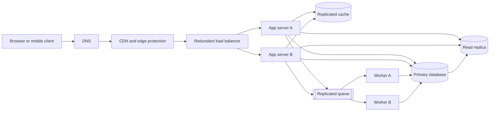

# QuickNotes Service Architecture

## Requirements

### Functional

- Users can register, authenticate, and manage their own notes.
- Users can create, read, update, and delete notes, and organize them with personal tags.
- Notes can be searched and listed with stable cursor pagination.
- The API validates input, isolates user data, and returns consistent errors.
- Asynchronous workers handle non-critical follow-up work such as search indexing and notifications.

### Non-functional

- Serve 1 million registered users with horizontal application scaling.
- Target 99.9% monthly API availability and p95 latency below 300 ms for ordinary reads and writes, excluding client network time.
- Encrypt traffic in transit and stored credentials at rest; authorize every resource operation by owner.
- Use automated backups and multi-zone failover, targeting an RPO of 5 minutes and RTO of 30 minutes.
- Support observability through correlated request IDs, metrics, structured logs, and alerts without logging note contents.

## Capacity Estimate

Planning assumptions: 1 million registered users; 20% are active on a typical day; each daily active user makes 20 note reads and creates 2 notes; peak traffic is 10 times the daily average. A stored note averages 2 KB including its row metadata but excluding indexes and replicas.

| Measure | Calculation | Planning value |
| --- | --- | --- |
| Reads/day | 1,000,000 x 20% x 20 | 4,000,000 |
| Average reads/second | 4,000,000 / 86,400 | about 46/s |
| Peak reads/second | 46 x 10 | about 460/s |
| Writes/day | 1,000,000 x 20% x 2 | 400,000 |
| Average writes/second | 400,000 / 86,400 | about 4.6/s |
| Peak writes/second | 4.6 x 10 | about 46/s |
| New note storage/year | 400,000 x 365 x 2 KB | about 292 GB/year |

The storage estimate counts new note payloads only and assumes no deletions. Allow roughly 1.5x for indexes, row overhead, and operational headroom: about 438 GB/year on the primary, plus a similarly sized read replica and backups. Attachments, audit history, and replication logs need separate capacity budgets. Requests are assumed to be reasonably distributed; load tests should validate the peak and cache-hit assumptions before launch.

## Architecture

| Component | Problem it solves |
| --- | --- |
| Client | Provides the user interface and sends authenticated API requests over HTTPS. |
| DNS | Resolves the service hostname and supports routing traffic to healthy regional entry points. |
| CDN and edge protection | Caches static assets near users and absorbs common network-layer attacks before they reach the API. |
| Load balancer | Distributes API requests across healthy app servers and removes unhealthy instances from rotation. |
| App servers A and B | Run stateless API logic and scale horizontally so one instance failure does not stop requests. |
| Replicated cache | Reduces database work for frequently read, short-lived data such as note-list pages and session metadata. |
| Primary database | Provides the durable transactional source of truth for users, notes, tags, and relationships. |
| Read replica | Offloads eligible read queries while preserving the primary for writes. |
| Replicated queue | Buffers asynchronous jobs and decouples request handling from slower follow-up work. |
| Workers A and B | Retry and process queued indexing or notification jobs independently of API request latency. |

The primary database transaction also writes an outbox event; a publisher delivers committed outbox records to the queue so a process crash cannot silently lose a follow-up job between commit and enqueue. Workers are idempotent because queue delivery may be repeated.

## Request Flows

### GET `/v1/notes`

1. The client resolves the service hostname through DNS and sends an HTTPS request with its bearer token and pagination parameters.
2. The CDN applies edge protections and forwards dynamic API traffic to the load balancer; it does not cache private note responses.
3. The load balancer selects a healthy app server, which authenticates the token and derives the owner ID from it.
4. The app checks the cache using a key scoped by owner and pagination/filter parameters. On a miss, it queries the read replica using the `(user_id, updated_at, id)` index.
5. If a client needs read-after-write consistency or the replica is unhealthy/too far behind, the app reads from the primary instead; it caches only appropriately scoped results with a short TTL.
6. The app returns the page and opaque next cursor. The client receives a request ID for support and tracing.

### POST `/v1/notes`

1. The client sends an authenticated JSON request and an optional idempotency key through DNS, CDN edge protection, and the load balancer.
2. The selected app server validates the title/body, checks authorization, and takes the user ID from the verified token rather than request JSON.
3. In one primary-database transaction, the app inserts the note and an outbox event; ownership and constraints are enforced by the schema.
4. After commit, the app invalidates or versions the affected user's list-cache entries and returns `201 Created` with the new note representation.
5. The outbox publisher places the event on the replicated queue; a worker consumes it to update search indexes or send notifications, retrying transient failures and routing exhausted jobs to a dead-letter queue.

## Trade-offs and Availability

- **Cache speed vs. freshness:** Caching reduces read latency and primary load but can briefly serve stale lists. Use short TTLs, owner-scoped keys, and mutation-triggered invalidation; route consistency-sensitive reads to the primary.
- **Read replicas vs. consistency:** Replicas increase read capacity but replicate asynchronously. Keep writes on the primary and provide a primary-read path when a recent write must immediately be visible.
- **Synchronous writes vs. queued side effects:** Returning success after the database commit keeps note creation durable and predictable, while search/notification work may lag. A transactional outbox, idempotent workers, retries, and a dead-letter queue prevent lost or endlessly retried jobs.
- **Availability vs. operational complexity:** Multi-zone redundancy costs more and requires failover testing, but avoids single-instance dependencies. Run multiple app servers and workers across zones; use redundant managed DNS, CDN, and load-balancer endpoints; configure the database replica for monitored automatic promotion; and deploy cache and queue as replicated clusters. Backups and tested restore/failover runbooks cover correlated failures that replicas alone cannot.